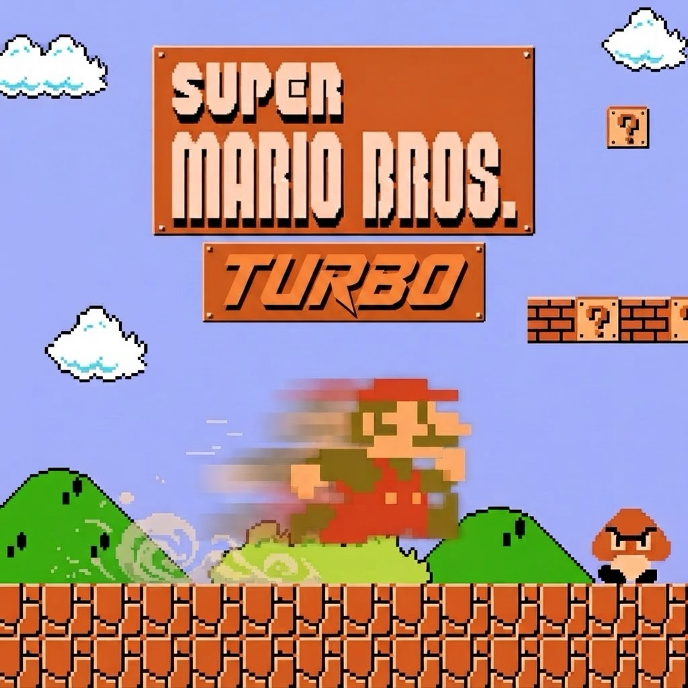

<p align="center">
  
  <br />
  <!-- repo-tagline:start -->
  <strong>🍄 More Mario rollouts. Less waiting ⚡</strong>
  <!-- repo-tagline:end -->
</p>

<p align="center">
  <a href="https://github.com/tsilva/env-SuperMarioBrosNes-turbo-emu/actions/workflows/ci.yml"></a>
  <a href="https://pypi.org/project/env-supermariobrosnes-turbo-emu/"></a>
  <a href="https://pypi.org/project/env-supermariobrosnes-turbo-emu/"></a>
  <a href="https://github.com/tsilva/env-SuperMarioBrosNes-turbo-emu/blob/main/LICENSE"></a>
</p>

SuperMarioBrosNes-turbo is a Python environment for parallel reinforcement
learning on Super Mario Bros NES. Run independent lanes through a deterministic
Gymnasium vector API and save state snapshots for repeatable experiments.

**15.4–17.3× the environment-step throughput of Stable Retro** in matched
benchmarks of historical v0.6.4 against Stable Retro v1.0.1 on a Ryzen 5 7600X.
See [workloads, methodology, and results](https://github.com/tsilva/env-SuperMarioBrosNes-turbo-emu/blob/main/BENCHMARKS.md).

## Quick start

Prebuilt wheels support Python `>=3.9` on Apple-silicon macOS 14 or newer
and x86-64 Linux with glibc 2.28 or newer.
Install the CLI with [uv](https://docs.astral.sh/uv/) and launch Level 1-1 with
your local ROM:

```bash
uv tool install env-supermariobrosnes-turbo-emu
smb-turbo play --rom /absolute/path/to/SuperMarioBros.nes
```

Playback opens a window and requires a discoverable SDL2 runtime; see
[playback setup](https://github.com/tsilva/env-SuperMarioBrosNes-turbo-emu/blob/main/API.md#playback) if SDL2 or `smb-turbo` is unavailable.
Use the arrow keys or `A`/`D` to move, `X`/`J`/Space to jump,
`Z`/`K`/Shift to run, and Escape to quit.

## Use from Python

Install `env-supermariobrosnes-turbo-emu` in your project, then follow the
[vector API guide](https://github.com/tsilva/env-SuperMarioBrosNes-turbo-emu/blob/main/API.md#turbo-vector-api-v2)
for actions, reset behavior, and snapshots. The
[GradLab examples](https://github.com/tsilva/env-SuperMarioBrosNes-turbo-emu/blob/main/API.md#gradlab-training)
cover local training. Bring a compatible ROM. ROM files are excluded from this
repository and package.

- [Register your ROM](https://github.com/tsilva/env-SuperMarioBrosNes-turbo-emu/blob/main/API.md#playback)
- [Native architecture](https://github.com/tsilva/env-SuperMarioBrosNes-turbo-emu/blob/main/ARCHITECTURE.md)
- [Build, test, and contribute](https://github.com/tsilva/env-SuperMarioBrosNes-turbo-emu/blob/main/CONTRIBUTING.md)

## License

[MIT License](https://github.com/tsilva/env-SuperMarioBrosNes-turbo-emu/blob/main/LICENSE).
See [NOTICE.md](https://github.com/tsilva/env-SuperMarioBrosNes-turbo-emu/blob/main/NOTICE.md)
for third-party names, marks, and user-supplied content.
